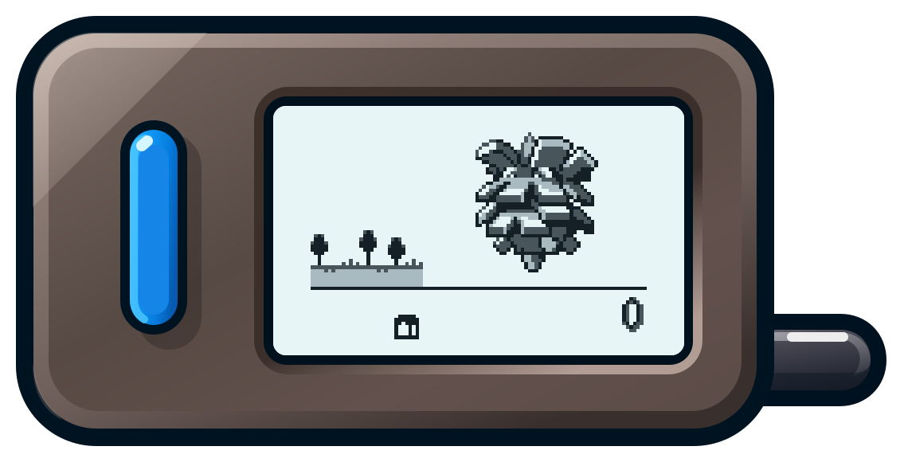

  

# Stickwalker

Stickwalker is firmware that turns an M5Stack Stick S3 into a recreation of the
Pokéwalker. Take a Pokémon from HeartGold or SoulSilver for a walk, earn Watts,
catch Pokémon and find items, then send your Pokémon and finds back to the game
over infrared.

I built it from my [binary-matching reconstruction of the Pokéwalker firmware](docs/h8-reconstruction.md).
It runs the original game logic, including step counting, minigames, progression,
sounds and communication with the games and other walkers.

## Get started

You'll need:

- An M5Stack Stick S3.
- A BPV10NF photodiode for receiving infrared. The Stick has a built-in transmitter.
- A USB-C data cable and a computer to install the firmware.
- An infrared-equipped HeartGold or SoulSilver Game Card and a console that can run it.

Download the firmware ZIP from [Releases](https://github.com/lumirth/stickwalker/releases),
then follow the [installation guide](stick/docs/install.md). It covers backups,
firmware updates and the two photodiode connections, G5 and GND. Once the Stick
is ready, [connect to your game and choose a Pokémon to take with you](stick/docs/playing.md).

The download uses placeholder pictures and a font for the built-in screens.
Pokémon and route artwork arrive from your game. You can also
[build the firmware](stick/docs/build.md) with
[artwork extracted from your own Pokéwalker firmware](assets/README.md).

## The Pokéwalker on the Stick S3

Step counting uses the Pokéwalker's original algorithm. Both devices use Bosch
accelerometers, the BMA150 in the Pokéwalker and the BMI270 in the Stick.
Stickwalker converts the readings to the original scale and processes them at
the original cadence, so step tracking should behave much like an original
Pokéwalker. [How step counting works](stick/docs/motion.md) explains the details.

The original 96×64 screen appears at twice its size on the Stick's display.
You can rotate it and choose a light or dark appearance. The speaker plays the
original tone sequences. Your Pokémon, route and progress stay saved across
restarts and firmware updates.

Walking continues while the screen is off. Hold M for half a second to wake it.
With the default controls, M moves left, R moves right, and M+R together
confirms. L opens Stick Settings. See [controls and settings](stick/docs/controls.md)
for the other button layouts.

## Help and contribute

To report a problem or work on the firmware, start with
[Contributing](CONTRIBUTING.md). The [development guide](stick/README.md) maps
out the code. [Release notes](https://github.com/lumirth/stickwalker/releases)
cover changes and testing for each version; the
[validation history](stick/docs/validation-history.md) records the device trials.

Stickwalker is an unofficial project by [lumirth](https://github.com/lumirth),
released under [MIT](LICENSE). Dependencies and marked assets have their own
[licenses and notices](docs/third-party.md). The
[references and acknowledgments](docs/references.md) credit the research and
tools used in the reconstruction and port.
