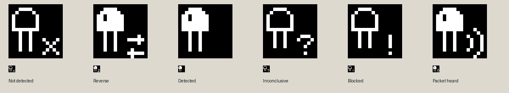

# Margin status validation

The margin now presents connection evidence and battery conditions only while relevant. The diode uses solid and outlined bodies, small opposing reversal arrows and curved waves for accepted packets. Fixed expected rasters check all six icons. The final atlas is extracted from compiled-firmware screenshots.

## Replaced behavior

The change removes the overloaded `DiodeFeedback` state, the packet check mark, the unconditional post-operation retention timer, the fixed three-recheck window, and the ignored connection-error argument. Preflight diagnostics no longer read the selected display icon. The connection record owns accepted-packet metadata. The transport no longer duplicates the result, preflight, or packet metadata. Settings replaces the heuristic summary with the record's observations.

The existing margin renderer now implements contextual battery visibility. It shares the runtime's supply observations instead of polling VBUS independently. The sensor's unused display-only states and tests for the old feedback model are removed. Existing probe calibration and electrical safety checks remain in use.

## Behavior exercised

- Safe but inconclusive preflight permits listening without an initial question mark. An advisory absence estimate also permits safe listening.
- Unsafe input still prevents strong precharge and transmission. Reversal and blocked indicators remain distinct.
- A peer that stops after one accepted packet produces a steady wave with a failed outcome. The original absence estimate and the accepted packet remain independently visible in Last connection. Opening Settings preserves the record; leaving the native result clears the margin.
- Successful exchange clears the diode immediately. Unregistered home has no inherited connection warning after the native result animation ends.
- Two consistent safe rechecks recognize correction. Captures every 200 ms check one continuous solid-diode interval lasting approximately two seconds, followed by a quiet margin and no further probing. One inconsistent check does not change the warning.
- Healthy battery and ordinary wake are quiet. Confirmed USB changes appear once, remain visible within the expected polling/display window, then expire. Connector chatter and unreadable supply measurements do not invent transitions.
- Low battery uses separate thresholds to enter and clear the warning. Transient or sustained read failures do not invent an empty battery or clear a known low warning. Only confirmed USB power suppresses that warning. USB changes while asleep leave the panel asleep and do not replay on wake.
- Both rotations and appearances retain the margin placement and original game area.

The timing workflows use actual compiled-firmware screens with fixed independent expected rasters and elapsed simulated input intervals. The voltage inputs exercise indicator behavior. They do not model battery discharge. The 3.34 V entry threshold is retained from the previous implementation. The 3.44 V clearing threshold adds hysteresis. Neither establishes remaining runtime.

## Qualification limits

Simulator workflows cannot establish physical diode detection accuracy across parts, optical conditions or boards. Actual cartridge exchange and physical-screen readability remain separate qualifications. The margin redesign preserves protocol retry behavior, packet formats, the receiver cutoff, charge timing, and save formats. The shared H8 preprocessed input is identical. The proprietary Renesas compilers were unavailable for a new binary comparison.

Paired-device validation uses an immutable full-flash backup, a separate simulated app-only upgrade input and independent output files. Private saves and captures stay outside version control. Installation writes only the application partition and checks EEPROM and NVS afterward.

Simulator flash output now uses exclusive file creation and refuses an existing regular file or symlink before boot. The unused arbitrary flash-export action is removed. CLI smoke checks confirmed both refusal paths preserved the original bytes, and a fresh compiled-firmware Settings run confirmed normal output still works.

## Recorded candidate

Build `dd1004db4c78` passed all 30 compiled-firmware scenarios at commit `610e03f`. Its application SHA-256 is `2a250ed2bcc32d001c7c60e8dd0be364bbdb540ab609c7ca5f0dfc0e2f2316e0`. The scenarios cover 12 status and UI cases, nine input and storage regressions, and nine optical exchanges. These include complete initial registration with distinct incoming artwork, Pokémon return, ordinary and compressed uploads, leading noise, a one-byte noise prefix, slower input timing, malformed packets followed by valid reads and Walker exchange. Optical cases use instruction and branch costs, transmitter echo, and flash program and erase delays.

The correction indicator occupied ten consecutive 200 ms captures, bounding its rendered duration to 1.8–2.2 seconds without flicker. Power-transition captures bound notification visibility around the two consistent one-second supply observations and the 2.5-second display interval. Both appearances and orientations passed fixed-raster checks. All six final source bitmaps also match the selected reference pixels exactly.

Formatting, static analysis, Python lint, and Rust formatting passed. The shared H8 preprocessed input has SHA-256 `bf16797147d494ab7973041e1f502ea7ab8ee9c310635d1d5e56dd6205bfb1dc`, identical to the preceding commit.

The paired device's full 8 MiB backup matched its live flash digest. A separate simulated application-only upgrade preserved all 65,536 EEPROM bytes and all NVS bytes. The production application was installed at `0x10000`. The programmer verified the written data hash. Read-only diagnostics identified build `dd1004db4c78` on the device.

Physical post-install readback checked all 65,536 decoded EEPROM bytes and all 20,480 NVS bytes against the verified backup: zero EEPROM differences and identical NVS. The registration and Pokémon-present flags remained set. The immutable backup, CRC-validated snapshots before and after the update, build manifest, screen captures, and result JSON are retained locally under `stick/.build/margin/`. Actual HGSS transfer and physical-screen readability were not qualified by this run.

Run `uv run python stick/check.py` to build the current source and repeat all 30 scenarios. The local status, regression, and optical cohorts took 5.2, 3.4, and 22.9 minutes. Their combined duration exceeds the previous 30-minute CI limit, so CI allows 60 minutes for setup, compilation, and the sequential workflows.

## PR preparation

Production and benchmark builds passed after comment cleanup and removal of an unused production timestamp read. Production build `8cb01eac70ef` passed the status/read, malformed-packet recovery, full-upload, and diode workflows. Removing the transport's unused icon-header dependency produced build `983b8aa97958`; its executable IRAM and flash code sections are byte-identical to that tested cleanup build. The decoder's code tokens and both shared H8 preprocessed inputs remain unchanged by this cleanup. The hardware record above applies to build `dd1004db4c78`.
